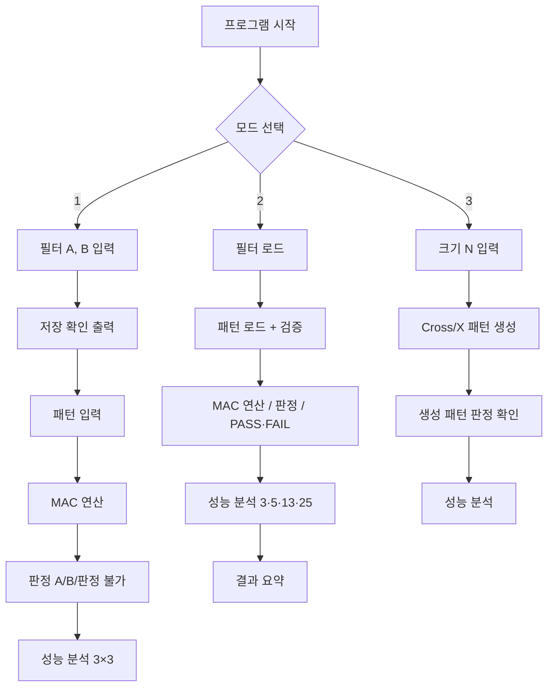
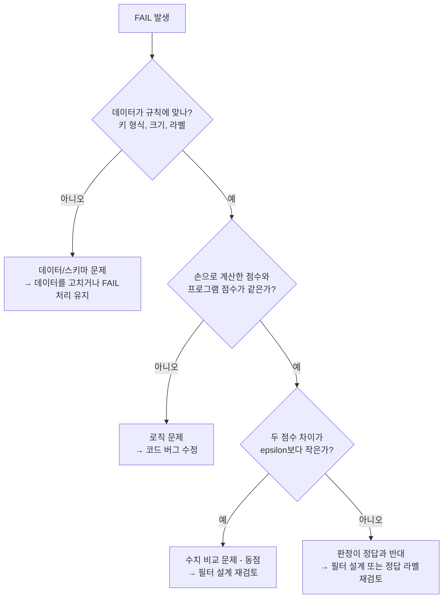

# Mini NPU Simulator

> **AI가 계산하는 방식을 흉내 내는 작은 계산기**
> 숫자로 된 그림이 **십자가(+)** 인지 **X** 인지, "곱하고 더하기(MAC)"만으로 판별하는 Python 프로그램입니다.

```
□ ■ □     ■ □ ■          0 1 0     1 0 1
■ ■ ■     □ ■ □    →     1 1 1     0 1 0     →   MAC 연산   →   "십자가입니다"
□ ■ □     ■ □ ■          0 1 0     1 0 1
(십자가)    (X)            숫자로 변환
```

이 README는 **프로젝트 설명서**이면서, 이 미션을 처음 공부하는 사람을 위한 **학습 교재**입니다.

---

## 목차

**Part 1. 시작하기**
- [1. 프로젝트 소개](#1-프로젝트-소개)
- [2. 실행 방법](#2-실행-방법)
- [3. 학습 로드맵: 이 순서로 공부하세요](#3-학습-로드맵-이-순서로-공부하세요)

**Part 2. 학습 가이드**
- [4. 관련 개념](#4-관련-개념)
- [5. 핵심 기능 해부: 코드 읽기](#5-핵심-기능-해부-코드-읽기)
- [6. 꼭 알아야 할 내용 6가지](#6-꼭-알아야-할-내용-6가지)
- [7. 알면 좋을 기타 내용](#7-알면-좋을-기타-내용)
- [8. 셀프 체크 퀴즈](#8-셀프-체크-퀴즈)
- [9. 직접 해보기 실습](#9-직접-해보기-실습)

**Part 3. 결과와 문서**
- [10. 프로그램 사용 예시](#10-프로그램-사용-예시)
- [11. 결과 리포트](#11-결과-리포트)
- [12. 보너스 과제](#12-보너스-과제)
- [13. 코드 구조와 요구사항 체크리스트](#13-코드-구조와-요구사항-체크리스트)
- [14. 용어 사전](#14-용어-사전)

---

# Part 1. 시작하기

## 1. 프로젝트 소개

AI 칩(NPU)이 가장 많이 하는 일은 **"같은 위치의 숫자끼리 곱해서 전부 더하기"** 입니다.
이 프로젝트에서는 그 계산을 Python으로 직접 만들어 보며 다음을 확인합니다.

- 이 계산만으로 십자가와 X를 **구별할 수 있는가?**
- 숫자 표가 커지면 계산 시간이 **얼마나 늘어나는가?**
- 계산하다 보면 생기는 **현실적인 문제들**을 어떻게 처리하는가?
  - 라벨 표기가 제각각인 문제
  - 소수 오차
  - 잘못된 데이터

| 항목 | 내용 |
|---|---|
| 언어 | Python 3.8 이상 |
| 제약 | NumPy 등 **외부 라이브러리 금지**. 표준 라이브러리(`json`, `time`, `re`, `os`, `sys`)만 사용 |
| 제출물 | `main.py`, `README.md` |
| 데이터 | `data.json`: 5×5, 13×13, 25×25 필터와 테스트 패턴 6개 |

---

## 2. 실행 방법

### 폴더 구성
```
mini_npu/
├── main.py      # 실행 파일 (이것 하나로 모든 기능이 동작)
├── data.json    # 분석용 데이터 (main.py와 같은 폴더에 있어야 함)
└── README.md    # 지금 읽고 있는 문서
```

### 실행
```bash
python main.py
```
> Mac이나 Linux에서 `python`이 안 되면 `python3 main.py`로 실행하세요.
> 다른 JSON 파일을 분석하려면 `python main.py my_test.json`처럼 경로를 붙입니다.

### 모드 선택

| 입력 | 모드 | 하는 일 |
|:-:|---|---|
| `1` | 사용자 입력 (3×3) | 필터 2개와 패턴을 직접 입력 → 점수, 판정, 시간 출력 |
| `2` | data.json 분석 | 파일 속 패턴 6개를 한 번에 판정 → PASS/FAIL, 성능 표, 결과 요약 |
| `3` | 패턴 생성기 (보너스) | 크기 N 입력 → N×N 십자가/X 자동 생성, 판정 확인, 성능 측정 |

### 실행 흐름



---

## 3. 학습 로드맵: 이 순서로 공부하세요

미션 학습 시간은 총 40시간입니다. 아래 순서를 권장합니다.

| 단계 | 공부할 것 | README 위치 | 직접 해볼 것 | 권장 시간 |
|:-:|---|---|---|:-:|
| 1 | 2차원 리스트, 이중 반복문 | [4-1](#4-1-python-기초) | 3×3 표를 만들고 값 바꿔 보기 | 3h |
| 2 | 필터와 MAC의 원리 | [4-2](#4-2-ai와-하드웨어), [5-2](#5-2-mac-연산-mac) | 종이에 3×3 MAC 손으로 계산하기 | 4h |
| 3 | 부동소수점과 epsilon | [4-3](#4-3-숫자-계산), [6-3](#6-3-부동소수점-오차와-epsilon) | `0.1 + 0.2` 직접 출력해 보기 | 5h |
| 4 | 라벨 정규화, JSON, 정규식 | [4-1](#4-1-python-기초), [6-2](#6-2-라벨-정규화) | data.json 열어서 구조 그려 보기 | 5h |
| 5 | 입력 검증, 예외 처리 | [5-5](#5-5-입력-검증과-재입력-read_matrix), [6-4](#6-4-오류가-나도-멈추지-않기) | 일부러 틀린 값 입력해 보기 | 5h |
| 6 | 시간 복잡도, 성능 측정 | [4-4](#4-4-알고리즘과-성능), [6-5](#6-5-시간-복잡도) | 모드 3에 N=51, 99 넣어 보기 | 5h |
| 7 | 실패 원인 진단 | [6-6](#6-6-실패-원인-진단법), [11](#11-결과-리포트) | 모드 2 결과를 직접 해석하기 | 5h |
| 8 | 퀴즈와 실습 | [8](#8-셀프-체크-퀴즈), [9](#9-직접-해보기-실습) | 실습 과제 풀기 | 8h |

> **학습 팁:** 코드를 처음부터 읽지 마세요. 먼저 `python main.py`로 세 모드를 모두 실행해 보고, 출력의 각 줄이 어느 함수에서 나오는지 찾아가며 읽는 것이 가장 빠릅니다.

---

# Part 2. 학습 가이드

## 4. 관련 개념

이 미션에 쓰이는 개념을 분야별로 정리했습니다. ⭐는 이 미션에서 특히 중요한 개념입니다.

### 4-1. Python 기초

| 개념 | 설명 | 이 프로젝트에서 |
|---|---|---|
| ⭐ **2차원 리스트** | 리스트 안에 리스트를 넣어 표를 표현합니다. `m[i][j]`는 i번 줄, j번 칸이고 번호는 0부터 셉니다. | 패턴과 필터 저장 |
| ⭐ **이중 반복문** | `for i` 안에 `for j`를 넣어 표의 모든 칸을 방문합니다. | MAC 연산 |
| **`input()`과 `split()`** | 한 줄을 입력받고 공백 기준으로 나눕니다. `"1 0 1".split()`은 `['1','0','1']`이 됩니다. | 모드 1 입력 |
| **형 변환 `float()`** | 문자열을 숫자로 바꿉니다. 바꿀 수 없으면 `ValueError`가 납니다. | 숫자 파싱 검증 |
| ⭐ **예외 처리 `try/except`** | 오류가 나도 프로그램이 죽지 않고 대처하게 합니다. | 입력 오류 재입력, 케이스별 FAIL |
| **딕셔너리 `dict`** | 키로 값을 찾는 자료형입니다. `{"+": "Cross"}["+"]`는 `"Cross"`입니다. | 라벨 번역표, JSON 데이터 |
| **JSON** | 데이터를 저장하고 주고받는 텍스트 형식입니다. `json.load()`로 읽으면 dict와 list가 됩니다. | data.json |
| **정규식 `re`** | 문자열 패턴을 검사하고 추출합니다. `^size_(\d+)_(\d+)$`는 "size_숫자_숫자" 형태만 허용합니다. | 키에서 N 추출 |
| **`isinstance()`** | 값의 자료형을 확인합니다. `isinstance(3.0, float)`는 `True`입니다. | 스키마 검증 |

**data.json의 구조**

```
data.json
├── filters
│   ├── size_5   ─┬─ cross : 5×5 표
│   │             └─ x     : 5×5 표
│   ├── size_13  ─┬─ cross : 13×13 표
│   │             └─ x     : 13×13 표
│   └── size_25  ─┬─ cross : 25×25 표
│                 └─ x     : 25×25 표
└── patterns
    ├── size_5_1  ─┬─ input    : 5×5 표
    │              └─ expected : "x"      ← 정답
    ├── size_5_2  ─┬─ input    : 5×5 표
    │              └─ expected : "+"
    └── ... (size_13_1, size_13_2, size_25_1, size_25_2)
```
키 이름 `size_13_2`는 "13×13 크기의 2번째 패턴"이라는 뜻입니다. 그래서 키에서 13을 꺼내 `size_13` 필터를 사용합니다.

### 4-2. AI와 하드웨어

| 개념 | 설명 |
|---|---|
| ⭐ **필터(Filter, 커널)** | 찾고 싶은 모양을 숫자로 적은 표입니다. 값이 큰 칸일수록 "이 칸이 중요하다"는 뜻입니다. |
| ⭐ **MAC 연산** | Multiply-Accumulate. 같은 칸끼리 곱하고(M), 결과를 계속 누적해서 더합니다(A). |
| **내적(Dot Product)** | 수학에서는 MAC을 "두 벡터의 내적"이라고 부릅니다. 두 데이터가 같은 방향을 볼수록 값이 커집니다. |
| **합성곱(Convolution)** | 실제 이미지 AI(CNN)는 필터를 그림 위에서 한 칸씩 **밀어 가며** 위치마다 MAC을 합니다. 이 미션은 그중 "한 위치"만 계산하는 단순화 버전입니다. |
| **CPU vs NPU** | CPU는 복잡한 일을 **하나씩 차례로**(직렬) 잘합니다. NPU는 단순한 MAC을 **수천 개 동시에**(병렬) 합니다. |

**MAC 계산 예시**

```
입력(십자가)   십자가 필터
 0 1 0          0 1 0        0×0 + 1×1 + 0×0
 1 1 1    ×     1 1 1   =  + 1×1 + 1×1 + 1×1   = 5점 (많이 닮음!)
 0 1 0          0 1 0      + 0×0 + 1×1 + 0×0

입력(십자가)   X 필터
 0 1 0          1 0 1
 1 1 1    ×     0 1 0   =  가운데 한 칸만 겹침  = 1점 (별로 안 닮음)
 0 1 0          1 0 1
```
십자가 필터 점수(5)가 X 필터 점수(1)보다 크므로 **"십자가"로 판정**합니다.

### 4-3. 숫자 계산

| 개념 | 설명 |
|---|---|
| ⭐ **부동소수점(float)** | 컴퓨터가 소수를 저장하는 방식입니다. 2진수로 저장하기 때문에 0.1 같은 수는 **정확히 저장되지 않습니다.** |
| ⭐ **epsilon(허용 오차)** | "이 정도 차이는 같은 값으로 보자"는 기준입니다. 이 프로젝트에서는 `1e-9` = 0.000000001을 씁니다. |
| **절대 오차 / 상대 오차** | 절대 오차는 차이 자체(`|a-b|`)를, 상대 오차는 값의 크기에 대한 차이의 비율을 봅니다. [7-3](#7-3-절대-오차-vs-상대-오차) 참고. |

### 4-4. 알고리즘과 성능

| 개념 | 설명 |
|---|---|
| ⭐ **시간 복잡도(Big-O)** | 입력 크기가 커질 때 계산량이 늘어나는 **경향**을 나타냅니다. O(N²)은 "N이 2배가 되면 계산량은 4배"라는 뜻입니다. |
| **성능 측정(벤치마크)** | 같은 작업을 여러 번 실행해 평균 시간을 냅니다. 한 번만 재면 우연한 잡음이 섞입니다. |
| **`time.perf_counter()`** | 짧은 시간을 정밀하게 재는 시계입니다. `time.time()`보다 측정에 적합합니다. |
| **워밍업** | 첫 실행은 준비 작업 때문에 느릴 수 있어서, 한 번 실행한 뒤부터 잽니다. |

---

## 5. 핵심 기능 해부: 코드 읽기

`main.py`의 주석에 **"N단계"** 가 표시되어 있습니다. 아래는 그중 핵심 함수를 발췌한 것입니다(일부 단순화).

### 5-1. 데이터 구조: `create_matrix`, `get_value`, `set_value`

```python
def create_matrix(n, fill=0.0):
    return [[fill for _ in range(n)] for _ in range(n)]   # n×n 표를 fill로 채움

def get_value(matrix, row, col):        # 특정 위치 읽기
    return matrix[row][col]

def set_value(matrix, row, col, value): # 특정 위치 쓰기
    matrix[row][col] = value
```

> ⚠️ **초보자 함정:** `[[0]*n]*n`으로 만들면 **모든 줄이 같은 리스트를 공유**합니다. 그래서 한 칸을 바꾸면 그 열 전체가 바뀝니다. 반드시 위처럼 줄마다 새 리스트를 만들어야 합니다.
> ```python
> bad = [[0]*3]*3;  bad[0][0] = 9;  print(bad)   # [[9,0,0],[9,0,0],[9,0,0]] 😱
> ```

### 5-2. MAC 연산: `mac`

```python
def mac(pattern, filt):
    n = len(pattern)
    total = 0.0                          # ① 누적할 변수를 0으로 시작
    for i in range(n):                   # ② 위에서 아래로 (줄)
        for j in range(n):               # ③ 왼쪽에서 오른쪽으로 (칸)
            total += pattern[i][j] * filt[i][j]   # ④ 곱하고(M) 더한다(A)
    return total                         # ⑤ 점수 반환
```
- 3×3이면 ④가 9번, 25×25면 625번 실행됩니다. 이것이 **O(N²)** 입니다.
- `sum()` 같은 함수를 쓰지 않고 반복문으로 직접 만든 이유는 과제 규칙 때문입니다. MAC의 원리를 눈으로 보기 위해서이기도 합니다.

### 5-3. 판정: `decide`

```python
EPSILON = 1e-9

def decide(score_a, score_b, label_a="A", label_b="B"):
    if abs(score_a - score_b) < EPSILON:   # 차이가 아주 작으면
        return "UNDECIDED"                 #   → 판정 불가
    return label_a if score_a > score_b else label_b   # 아니면 큰 쪽
```
- `abs()`는 절댓값입니다. a−b가 음수일 수 있어서 씁니다.
- 모드 1에서는 `"A"`/`"B"`, 모드 2에서는 `"Cross"`/`"X"`를 넘겨서 **같은 함수를 재사용**합니다.

### 5-4. 라벨 정규화: `normalize_label`

```python
LABEL_MAP = {"+": "Cross", "cross": "Cross", "x": "X"}

def normalize_label(raw):
    if raw is None:
        return None
    return LABEL_MAP.get(str(raw).strip().lower())
    #                    ① 문자열로  ② 앞뒤 공백 제거  ③ 소문자로  ④ 번역표에서 찾기
```
- `" X "`, `"x"`, `"X"`는 모두 `"X"`가 됩니다.
- `dict.get()`은 키가 없으면 오류 대신 `None`을 돌려줍니다. 그래서 모르는 라벨이 와도 프로그램이 죽지 않습니다.

### 5-5. 입력 검증과 재입력: `read_matrix`

```python
def read_matrix(name, n):
    matrix = []
    while len(matrix) < n:                 # n줄을 다 받을 때까지 반복
        parts = input().split()
        if len(parts) != n:                # 검사 ①: 숫자 개수
            print("입력 형식 오류: 각 줄에 {}개의 숫자를 ...".format(n))
            continue                       # 이 줄을 버리고 다시 입력받음
        try:
            row = [float(p) for p in parts]   # 검사 ②: 숫자로 바뀌는가?
        except ValueError:
            print("입력 형식 오류: 숫자가 아닌 값이 있습니다.")
            continue
        matrix.append(row)                 # 통과한 줄만 저장
    return matrix
```
- `continue`는 "이번 반복을 건너뛰고 처음으로 돌아가라"는 뜻입니다. 틀린 줄만 다시 입력받는 원리입니다.

### 5-6. 케이스 분석: `analyze_case` (모드 2의 핵심)

```python
def analyze_case(key, case, filters, filter_errors):
    m = KEY_PATTERN.match(key)          # ① "size_13_2" → 13 추출
    if not m:  return FAIL("[스키마] 키 형식 오류")
    n = int(m.group(1))

    expected = normalize_label(case.get("expected"))   # ② "+" → "Cross"
    if expected is None:  return FAIL("[라벨] ...")

    if n not in filters:  return FAIL("[스키마] 필터 없음")   # ③ 필터 선택

    reason = check_square(case.get("input"), n)       # ④ 크기 검증
    if reason:  return FAIL("[크기] ...")

    score_cross = mac(pattern, filters[n]["Cross"])   # ⑤ MAC
    score_x     = mac(pattern, filters[n]["X"])
    verdict = decide(score_cross, score_x, "Cross", "X")   # ⑥ 판정
    return PASS if verdict == expected else FAIL(...)
```
> 실제 코드에서는 `FAIL(...)` 대신 결과 dict에 사유를 담아 반환합니다. 위는 흐름을 보여 주기 위한 의사 코드입니다.

**설계 포인트:** 이 함수는 어떤 문제가 생겨도 **예외를 밖으로 던지지 않고**, "FAIL + 사유"를 돌려줍니다. 그래서 한 케이스가 망가져도 나머지 케이스는 계속 분석됩니다.

### 5-7. 시간 측정: `measure_ms`

```python
def measure_ms(func, *args):
    func(*args)                              # 워밍업 1회 (측정 제외)
    best = None
    for _ in range(5):                       # "10회 평균" 측정을 5번 반복
        start = time.perf_counter()
        for _ in range(10):
            func(*args)                      # MAC 함수 호출 구간만 측정
        avg = (time.perf_counter() - start) / 10 * 1000   # 초 → ms
        best = avg if best is None else min(best, avg)
    return best                              # 가장 방해를 덜 받은 값
```
- `*args`는 "인자를 몇 개든 받아서 그대로 전달"하는 문법입니다. 그래서 `mac`과 `mac_flat` 모두 이 함수 하나로 측정할 수 있습니다.
- **5번 중 최솟값을 쓰는 이유:** MAC 한 번은 0.001ms 수준이라, 그 순간 컴퓨터가 다른 일을 하면 값이 크게 튑니다. 최솟값이 "방해 없는 실제 계산 시간"에 가장 가깝습니다.

---

## 6. 꼭 알아야 할 내용 6가지

과제의 **학습 목표 6가지**와 1:1로 대응합니다. 미션을 마쳤다면 이 6가지를 **남에게 설명할 수 있어야** 합니다.

### 6-1. MAC 연산과 유사도 점수

> **한 줄 요약:** 같은 칸끼리 곱해서 모두 더한 값이 "닮은 정도" 점수다.

- **원리:** 입력과 필터가 **둘 다 큰 값**인 칸에서만 곱이 커집니다. 그래서 모양이 겹칠수록 점수가 올라갑니다.
- **AI에서 중요한 이유:** 이미지 인식, 음성 인식, 언어 모델 등 거의 모든 신경망 계산의 대부분이 MAC입니다. 고화질 이미지 한 장을 처리하는 데 수억 번이 필요합니다.
- **기억할 것:** 점수는 **상대 비교용**입니다. "5점"이라는 숫자 자체보다, 다른 필터 점수보다 큰지가 중요합니다.

### 6-2. 라벨 정규화

> **한 줄 요약:** 같은 뜻의 다른 표기(`+`, `cross`, `x`)를 프로그램 안에서 `Cross`, `X` 두 가지로 통일한다.

- **문제:** data.json은 정답을 `+`와 `x`로, 필터 이름을 `cross`와 `x`로 적습니다. 같은 십자가인데 `"+" == "cross"`는 `False`입니다.
- **정규화를 안 하면:** 판정 결과(`Cross`)와 정답(`+`)이 글자가 달라서 **6개 모두 FAIL**이 됩니다.
- **원칙:** 데이터는 **들어오는 입구에서 한 번** 정규화합니다. 그 뒤 프로그램 내부는 표준 라벨만 씁니다. 비교하는 곳마다 따로 처리하면 언젠가 빠뜨립니다.
- **실무 연결:** 실제 데이터에는 `"Seoul"`, `"seoul "`, `"서울"`이 섞여 있는 일이 흔합니다. 이 작업을 **데이터 전처리(정제)** 라고 하며, 실무 데이터 작업의 큰 부분을 차지합니다.

### 6-3. 부동소수점 오차와 epsilon

> **한 줄 요약:** 컴퓨터의 소수는 아주 조금씩 틀리므로, `==`나 `>`로 바로 비교하지 말고 "차이가 충분히 작으면 같다"고 판단한다.

**왜 오차가 생기나요?** 10진수 1/3 = 0.3333…이 끝나지 않듯이, **2진수에서는 0.1이 끝나지 않습니다.** 그래서 컴퓨터는 가장 가까운 값으로 반올림해서 저장합니다.

```python
>>> 0.1 + 0.2
0.30000000000000004
>>> from decimal import Decimal; Decimal(0.1)     # 실제로 저장된 0.1의 정확한 값
Decimal('0.1000000000000000055511151231257827021181583404541015625')
```

**판정에 주는 영향:** 이 프로젝트의 data.json에는 수학적으로 **정확히 동점**인 케이스가 3개 있습니다. 그런데 컴퓨터로 계산하면 오차 때문에 한쪽이 아주 조금 커집니다.

```
size_5_1:  Cross 0.9   vs   X 0.8999999999999999
           → ">" 로 비교하면 "Cross가 이겼다" (근거 없는 판정!)
           → epsilon 으로 비교하면 "판정 불가" (정직한 판정)
```

**epsilon 값은 어떻게 정하나요?**
- 판정할 수 없는 동점 케이스의 오차는 약 **1e-15** 수준입니다.
- 진짜로 구분되는 케이스의 점수 차이는 최소 **8.8**입니다.
- epsilon은 이 두 값 **사이**에 있으면 됩니다. 1e-9는 양쪽에서 충분히 멀어 안전합니다.

### 6-4. 오류가 나도 멈추지 않기

> **한 줄 요약:** 잘못된 입력은 **사람이면 다시 묻고**, **파일이면 그 건만 FAIL 처리**한 뒤 계속 진행한다.

| 상황 | 처리 방식 | 이유 |
|---|---|---|
| 모드 1에서 사람이 잘못 입력 | 안내 후 **그 줄만 재입력** | 사람은 바로 고칠 수 있으니까 |
| 모드 2에서 데이터 한 건이 잘못됨 | **그 케이스만 FAIL**과 사유 기록, 다음 케이스 진행 | 파일은 실행 중에 고칠 수 없으니까. 1건 때문에 나머지 100건을 못 보면 손해 |
| 파일이 없거나 JSON 문법 오류 | 안내 메시지 출력 후 종료 | 분석할 데이터 자체가 없으니까 |

- 이런 태도를 **방어적 프로그래밍**이라고 합니다. "데이터는 언제든 잘못될 수 있다"고 가정하고 검사합니다.
- **검사 순서도 중요합니다.** 키 형식 → 라벨 → 필터 존재 → 크기 순서로 검사합니다. 크기가 틀린 표로 MAC을 돌리면 `IndexError`가 나거나, 더 나쁘게는 **틀린 점수가 조용히** 나올 수 있습니다.

### 6-5. 시간 복잡도

> **한 줄 요약:** O(N²). N×N 표의 MAC은 곱셈을 N²번 하므로, N이 2배가 되면 시간이 약 4배가 된다.

| 크기 | 연산 횟수(N²) | 측정 시간(ms) | 시간 비율 (vs 13×13) | 연산 비율 (vs 13×13) |
|:-:|:-:|:-:|:-:|:-:|
| 13×13 | 169 | 0.0059 | 1.0배 | 1.0배 |
| 25×25 | 625 | 0.0202 | **3.4배** | **3.7배** |

- **근거 ① 코드:** 이중 반복문이 N × N번 돕니다.
- **근거 ② 측정:** 연산 횟수가 3.7배일 때 시간도 3.4배로, 거의 비례합니다.
- **주의:** 아주 작은 크기(3×3)는 반복문 준비 같은 **고정 비용** 때문에 비례 관계가 흐려집니다. 그래서 Big-O는 **N이 충분히 클 때의 경향**을 봅니다.

### 6-6. 실패 원인 진단법

> **한 줄 요약:** FAIL이 나면 바로 코드를 고치지 말고, **데이터 / 로직 / 수치** 중 어디 문제인지 먼저 가른다.



이 프로젝트의 FAIL 3건은 모두 **수치 비교 문제(동점)** 입니다. 자세한 분석은 [11-2](#11-2-실패-원인-분석)를 보세요.

> ⚠️ **하지 말아야 할 것:** FAIL을 없애려고 epsilon을 바꾸거나, 동점일 때 한쪽을 고르게 만드는 것. 이는 **문제를 고친 것이 아니라 숨긴 것**입니다.

---

## 7. 알면 좋을 기타 내용

과제 통과에 꼭 필요하지는 않지만, 알면 이해가 깊어지는 내용입니다.

### 7-1. 이 미션에서 실제 AI로: 합성곱(Convolution)

이 미션은 그림과 필터의 크기가 같아서 MAC을 **한 번**만 합니다. 실제 CNN(이미지 인식 AI)은 큰 그림 위에서 작은 필터를 **한 칸씩 밀면서** 위치마다 MAC을 합니다.

```
큰 그림 (6×6)            3×3 필터를 밀면서 MAC
┌─┬─┬─┬─┬─┬─┐
│■│■│■│ │ │ │  ← 위치 (0,0)에서 MAC 1번
│■│■│■│ │ │ │
│■│■│■│ │ │ │  → 오른쪽으로 한 칸 이동 → 또 MAC ...
│ │ │ │ │ │ │
│ │ │ │ │ │ │  결과: 4×4 = 16개 위치 × 9번 곱셈 = 144번
│ │ │ │ │ │ │
└─┴─┴─┴─┴─┴─┘
```
- 그림 H×W, 필터 K×K일 때 계산량은 **(H−K+1) × (W−K+1) × K²** 입니다.
- 여기에 필터 수백 개와 층 수십 개가 곱해지므로, MAC이 수억 번 필요해집니다.

### 7-2. 진짜 NPU는 어떻게 생겼나

- 구글의 1세대 TPU(NPU의 일종)에는 **65,536개(256×256)의 MAC 유닛**이 격자 모양으로 배치되어 있습니다. 이 구조를 **시스톨릭 어레이(Systolic Array)** 라고 합니다.
- 데이터가 격자를 따라 흘러가면서, 각 칸이 동시에 곱하고 더해 옆 칸으로 넘깁니다. 우리 코드의 이중 반복문을 **하드웨어로 펼쳐 놓은 것**이라고 생각하면 됩니다.
- 실제 NPU는 float 대신 **8비트 정수(INT8)** 를 많이 씁니다(양자화). 정수 곱셈과 덧셈은 칩 면적과 전력을 크게 아끼고, 덧셈 순서에 따른 반올림 오차도 생기지 않습니다.

### 7-3. 절대 오차 vs 상대 오차

이 프로젝트는 과제 규칙에 따라 **절대 오차**(`|a−b| < 1e-9`)를 씁니다. 다만 값의 크기에 따라 함정이 있습니다.

```python
# 큰 값: 0.1을 10번 더한 뒤 10억을 곱하면
a = 999999999.9999999;  b = 1000000000.0
abs(a - b)               # 1.19e-07 → 1e-9보다 커서 "다르다"고 판정 (실제론 같은 값인데!)

# 아주 작은 값
abs(1e-12 - 2e-12)       # 1e-12 → 1e-9보다 작아서 "같다"고 판정 (실제론 2배 차이인데!)
```
- **상대 오차:** 값의 크기에 비례해 허용 범위를 정합니다. 표준 라이브러리 `math.isclose(a, b, rel_tol=1e-9, abs_tol=…)`가 두 방식을 함께 지원합니다.
- 이 프로젝트의 점수는 0.1~53 범위라서 절대 오차로 충분합니다.

### 7-4. 오차는 "더하는 순서"와 "더하는 방법"에 따라 달라진다

```python
s = 0.0
for _ in range(10): s += 0.1
print(s)                        # 0.9999999999999999

import math
math.fsum([0.1] * 10)           # 1.0  ← 오차를 보정해 정확히 더하는 함수
```
- data.json의 동점 3건을 `math.fsum`으로 계산하면 **양쪽 모두 정확히 0.9 / 7.5 / 4.9** 가 나옵니다. 오차 때문에 생긴 착시가 아니라 **진짜 동점**이라는 증거입니다.
- 참고로 Python 3.12부터는 내장 `sum()`도 오차 보정 덧셈을 합니다. 그래서 같은 계산이라도 **반복문과 `sum()`의 결과가 다를 수 있습니다.** epsilon이 필요한 또 하나의 이유입니다.

### 7-5. 점수의 함정: 필터 가중치가 크면 점수가 왜곡된다

MAC 점수는 필터 값의 **크기**에 영향을 받습니다. data.json의 13×13 X 필터는 가운데 한 칸이 7.5로 매우 큽니다. 그래서 가운데 한 칸만 겹쳐도 높은 점수가 나옵니다.

**해결 아이디어: 코사인 유사도.** MAC 점수를 두 표의 "크기"로 나누어, 크기와 상관없이 **모양이 얼마나 같은 방향인지**만 봅니다(값은 0~1).

```
코사인 유사도 = MAC(입력, 필터) / ( √MAC(입력, 입력) × √MAC(필터, 필터) )
```

| 케이스 | 정답 | Cross | X | 판정 |
|---|:-:|:-:|:-:|:-:|
| size_5_1 | X | 0.101 | **1.000** | ✅ X |
| size_13_2 | Cross | **1.000** | 0.196 | ✅ Cross |
| size_25_1 | X | 0.082 | **1.000** | ✅ X |

MAC 점수로는 동점이던 3건이 코사인 유사도로는 **모두 정답**이 됩니다. 나머지 3건도 정답입니다. 다만 과제 규칙은 "MAC 점수 비교"이므로 프로그램에는 반영하지 않았습니다. [실습 9-4](#9-직접-해보기-실습)로 직접 구현해 보세요.

### 7-6. Python 반복문이 느린 이유와 NumPy가 빠른 이유

- Python은 `total += a * b` 한 줄을 실행할 때마다 자료형 확인, 객체 생성 같은 **부가 작업**을 많이 합니다. 그래서 곱셈 1번에 약 30~80ns가 걸립니다.
- NumPy는 같은 계산을 **C 언어로 한꺼번에** 처리하고, CPU의 **SIMD**(한 명령으로 여러 숫자 계산) 기능도 씁니다. 그래서 수십~수백 배 빠릅니다.
- 이 미션에서 NumPy를 금지한 이유는 **원리를 직접 체험하기 위해서**입니다. 실무에서는 NumPy나 PyTorch를 씁니다.

### 7-7. 1차원 배열이 빨라진 진짜 이유

- C 언어 같은 저수준 언어에서는 1차원 배열이 메모리에 **연속으로** 놓여 있어서 **캐시 효율**이 좋아집니다.
- Python 리스트는 숫자 자체가 아니라 숫자 객체의 **주소**를 저장합니다. 그래서 캐시 효과는 거의 없습니다.
- 이 프로젝트에서 1D가 빨라진 주된 이유는 **바깥 반복문과 `pattern[i]` 조회가 사라져 Python이 할 일이 줄었기 때문**입니다.

### 7-8. 다음 단계로 배우면 좋은 것

| 주제 | 이유 |
|---|---|
| `unittest` / `pytest` | 이번처럼 "일부러 틀린 데이터" 테스트를 자동화할 수 있습니다. |
| `timeit` 모듈 | 표준 라이브러리의 정식 성능 측정 도구입니다. |
| NumPy | 같은 MAC을 `(a * b).sum()` 한 줄로 쓰고, 속도를 비교해 보세요. |
| CNN 기초 | 7-1의 합성곱이 실제로 이미지 인식에 어떻게 쓰이는지 배웁니다. |
| Git과 GitHub | 코드 변경 이력 관리와 협업의 기본입니다. |

---

## 8. 셀프 체크 퀴즈

답을 먼저 생각해 본 뒤 ▶ 를 눌러 확인하세요.

<details>
<summary><b>Q1.</b> 입력 <code>[[1,0],[0,1]]</code>, 필터 <code>[[1,1],[0,1]]</code>의 MAC 점수는?</summary>

1×1 + 0×1 + 0×0 + 1×1 = **2**
</details>

<details>
<summary><b>Q2.</b> 25×25 MAC은 5×5 MAC보다 곱셈을 몇 배 많이 하나요?</summary>

625 ÷ 25 = **25배**. N이 5배이므로 N²은 25배입니다.
</details>

<details>
<summary><b>Q3.</b> <code>0.1 + 0.2 == 0.3</code>의 결과와 그 이유는?</summary>

**False**. 0.1과 0.2는 2진수로 정확히 표현되지 않아서, 더한 결과가 0.30000000000000004가 되기 때문입니다.
</details>

<details>
<summary><b>Q4.</b> 라벨 정규화를 빼면 data.json 결과는 어떻게 되나요?</summary>

판정 결과는 `Cross`/`X`인데 정답은 `+`/`x`라서 글자가 일치하지 않습니다. **6개 모두 FAIL**이 됩니다.
</details>

<details>
<summary><b>Q5.</b> 모드 1에서 사용자가 잘못 입력하면 재입력을 받는데, 모드 2에서는 왜 FAIL로만 처리하나요?</summary>

사람은 그 자리에서 고쳐 입력할 수 있지만, 파일 데이터는 실행 중에 고칠 수 없습니다. 잘못된 1건 때문에 전체를 멈추면 나머지 정상 케이스의 결과도 못 봅니다.
</details>

<details>
<summary><b>Q6.</b> size_13_2의 Cross 점수가 7.499999999999997, X 점수가 7.5입니다. epsilon 없이 <code>></code>로 판정하면 결과는?</summary>

X가 더 크므로 **X로 판정**됩니다. 정답은 Cross이므로 FAIL입니다. 더 큰 문제는, 수학적으로는 동점인데 반올림 오차 때문에 근거 없이 X로 "확신"했다는 점입니다.
</details>

<details>
<summary><b>Q7.</b> data.json의 FAIL 3건은 데이터, 로직, 수치 중 어느 문제인가요? 그 근거는?</summary>

**수치 비교(동점) 문제**입니다.
- 데이터: 키, 크기, 라벨이 모두 정상입니다.
- 로직: 손계산과 프로그램 점수가 같습니다.
- 수치: 필터가 "가운데 값 1개 = 작은 값 × 여러 칸"이 되도록 설계되어 수학적으로 동점입니다. 예: 0.9 × 1 = 0.1 × 9.
</details>

<details>
<summary><b>Q8.</b> 1차원 최적화를 하면 시간 복잡도가 바뀌나요?</summary>

**바뀌지 않습니다.** 곱셈 횟수는 여전히 N²번이라 O(N²)입니다. 최적화는 곱셈 1번당 드는 시간(상수)만 줄입니다.
</details>

<details>
<summary><b>Q9.</b> 성능 측정에서 입력이나 파일 읽기 시간을 빼는 이유는?</summary>

사람이 타이핑하는 속도나 디스크 속도는 MAC 연산과 상관없기 때문입니다. 측정하고 싶은 것은 **연산 자체의 비용**입니다.
</details>

<details>
<summary><b>Q10.</b> 패턴 생성기에서 N을 홀수로 제한한 이유는?</summary>

짝수면 정가운데 칸이 없어서 십자가의 가로줄과 세로줄이 한쪽으로 치우칩니다.
</details>

---

## 9. 직접 해보기 실습

쉬운 것부터 순서대로 해 보세요. ★이 많을수록 어렵습니다.

| # | 난이도 | 실습 | 확인할 것 |
|:-:|:-:|---|---|
| 9-1 | ★ | 모드 1에서 필터 A=십자가, B=X로 두고, 패턴에 **두 모양을 합친 그림**(`1 1 1 / 1 1 1 / 1 1 1`)을 넣어 보기 | 점수가 각각 5와 5로 같아서 판정 불가가 나오는가? |
| 9-2 | ★ | `EPSILON`을 `1e-20`으로 바꾸고 모드 2 실행 | 동점 3건이 UNDECIDED 대신 어떤 판정이 되는가? 그 판정은 정답인가? |
| 9-3 | ★★ | data.json을 복사해 5×5 X 필터의 대각선을 0.1에서 1.0으로 바꾸고 `python main.py 복사본.json` 실행 | size_5_1이 PASS로 바뀌는가? |
| 9-4 | ★★ | `cosine(pattern, filt)` 함수를 만들어 모드 2의 MAC 대신 써 보기 ([7-5](#7-5-점수의-함정-필터-가중치가-크면-점수가-왜곡된다)) | 6개 모두 PASS가 되는가? |
| 9-5 | ★★ | `decide`를 `math.isclose`(상대 오차)로 바꿔 보기 | 결과가 같은가? 왜 같은가? |
| 9-6 | ★★ | 세 번째 모양 **"ㅁ(테두리)"** 필터를 추가해서 3개 중 1개를 고르게 만들기 | 동점이 여러 개면 어떻게 처리할 것인가? |
| 9-7 | ★★★ | 7×7 그림 위에서 3×3 필터를 미는 **합성곱** 함수 만들기 ([7-1](#7-1-이-미션에서-실제-ai로-합성곱convolution)) | 결과 표의 크기가 5×5인가? |
| 9-8 | ★★★ | `unittest`로 `mac`, `decide`, `normalize_label` 테스트 작성 | `python -m unittest`로 모두 통과하는가? |

---

# Part 3. 결과와 문서

## 10. 프로그램 사용 예시

### 모드 1: 직접 입력

```
선택: 1
필터 입력 방식 (1: 직접 입력, 2: 패턴 생성기 A=Cross, B=X): 1
필터 A (3줄 입력, 공백 구분)
0 1 0
1 1 1
0 1 0

필터 B (3줄 입력, 공백 구분)
1 0 1
0 1 0
1 0 1

✓ 필터 저장 완료
...
패턴 입력 방식 (1: 직접 입력, 2: 생성기 Cross, 3: 생성기 X): 1
패턴 (3줄 입력, 공백 구분)
1 0 1
0 1 0
1 0 1

# [3] MAC 결과
A 점수: 1.0
B 점수: 5.0
연산 시간(평균/10회): 0.0004 ms
판정: B
```

**잘못 입력하면?** 프로그램이 멈추지 않고, 틀린 줄만 다시 입력받습니다.
```
1 0          ← 숫자가 2개뿐
입력 형식 오류: 각 줄에 3개의 숫자를 공백으로 구분해 입력하세요. (1번째 줄 다시 입력)
1 a 0        ← 숫자가 아닌 글자
입력 형식 오류: 숫자가 아닌 값이 있습니다. (1번째 줄 다시 입력)
```

**점수가 사실상 같으면?** (필터 A `0.3 0 0`, 필터 B `0.1 0.2 0`, 패턴 `1 1 0`, 나머지 줄은 모두 0)
```
A 점수: 0.3
B 점수: 0.30000000000000004
판정: 판정 불가 (|A-B| < 1e-09)
```

### 모드 2: data.json 분석 (실제 실행 결과)

```
# [1] 필터 로드
✓ size_5  필터 로드 완료 (Cross, X)
✓ size_13 필터 로드 완료 (Cross, X)
✓ size_25 필터 로드 완료 (Cross, X)

# [2] 패턴 분석 (라벨 정규화 적용)
--- size_5_1 ---
Cross 점수: 0.9
X 점수: 0.8999999999999999
판정: UNDECIDED | expected: X | FAIL
--- size_5_2 ---
Cross 점수: 8.9
X 점수: 0.1
판정: Cross | expected: Cross | PASS
... (생략) ...

# [3] 성능 분석 (평균/10회)
크기             평균 시간(ms)       연산 횟수
----------------------------------------
3×3               0.0007           9
5×5               0.0014          25
13×13             0.0059         169
25×25             0.0202         625

# [4] 결과 요약
총 테스트: 6개
통과: 3개
실패: 3개

실패 케이스:
- size_5_1: [수치] 동점(UNDECIDED) - |Cross-X|=1.11e-16 < 1e-09
- size_13_2: [수치] 동점(UNDECIDED) - |Cross-X|=2.66e-15 < 1e-09
- size_25_1: [수치] 동점(UNDECIDED) - |Cross-X|=1.78e-15 < 1e-09
```

모드 2는 실패 사유에 원인별 **태그**를 붙입니다.

| 태그 | 의미 | 예시 |
|---|---|---|
| `[스키마]` | 데이터 구조가 잘못됨 | 키 이름 오류, 필터 없음, 숫자 자리에 글자 |
| `[크기]` | 필터와 패턴의 크기가 다름 | 13×13 필터에 12줄짜리 패턴 |
| `[라벨]` | 정답 값을 해석할 수 없음 | `"o"`, 정답 누락 |
| `[수치]` | 소수 오차로 인한 동점 | \|Cross−X\| < 1e-9 |
| `[판정]` | 판정이 정답과 다름 | 로직 오류나 정답 라벨 오류 의심 |

### 모드 3: 패턴 생성기 (N = 7)

```
크기 N 입력 (3~99 사이 홀수): 7
Cross 패턴 (7×7):            X 패턴 (7×7):
  0 0 0 1 0 0 0                1 0 0 0 0 0 1
  0 0 0 1 0 0 0                0 1 0 0 0 1 0
  0 0 0 1 0 0 0                0 0 1 0 1 0 0
  1 1 1 1 1 1 1                0 0 0 1 0 0 0
  0 0 0 1 0 0 0                0 0 1 0 1 0 0
  0 0 0 1 0 0 0                0 1 0 0 0 1 0
  0 0 0 1 0 0 0                1 0 0 0 0 0 1

--- Cross 패턴 ---
Cross 점수: 13.0 | X 점수: 1.0
판정: Cross | expected: Cross | PASS
```
(실제 출력에서는 두 패턴이 위아래로 나옵니다. 여기서는 보기 쉽게 나란히 놓았습니다.)

---

## 11. 결과 리포트

### 11-1. data.json 판정 결과

| 케이스 | 정답 (원본 → 정규화) | Cross 점수 | X 점수 | 판정 | 결과 |
|---|---|---|---|---|:-:|
| size_5_1 | `x` → X | 0.9 | 0.8999999999999999 | UNDECIDED | ❌ FAIL |
| size_5_2 | `+` → Cross | 8.9 | 0.1 | Cross | ✅ PASS |
| size_13_1 | `x` → X | 0.3 | 14.700000000000008 | X | ✅ PASS |
| size_13_2 | `+` → Cross | 7.499999999999997 | 7.5 | UNDECIDED | ❌ FAIL |
| size_25_1 | `x` → X | 4.9 | 4.899999999999999 | UNDECIDED | ❌ FAIL |
| size_25_2 | `+` → Cross | 52.9 | 0.1 | Cross | ✅ PASS |

**총 6개 / 통과 3개 / 실패 3개**

### 11-2. 실패 원인 분석

실패한 3건이 어디서 생겼는지 [6-6의 진단법](#6-6-실패-원인-진단법)으로 하나씩 확인했습니다.

**① 데이터/스키마 문제인가? → 아니다**
- 6개 패턴 모두 키 이름(`size_N_idx`)과 크기(N×N)가 정확합니다.
- 정답 값은 `x`와 `+` 두 종류뿐이고, 정규화하면 모두 X와 Cross로 해석됩니다.
- 참고로 라벨 정규화를 하지 않았다면 **6개 모두 FAIL**이었습니다. 정규화로 이 문제를 없앴습니다.

**② 로직(MAC/판정 코드) 문제인가? → 아니다**
- 과제 문서의 예시(십자가 × 십자가 = 5점, 십자가 × X = 1점)와 계산이 일치합니다.
- 점수 차이가 분명한 3건(size_5_2, size_13_1, size_25_2)은 모두 정답으로 판정했습니다.

**③ 수치 비교 문제인가? → 그렇다. 필터가 애초에 동점이 나오도록 만들어져 있다**

십자가와 X가 겹치는 칸은 **가운데 한 칸뿐**입니다. 반대 모양을 넣으면 한쪽 필터는 "가운데 값 1개"만, 다른 쪽 필터는 "작은 값 × 여러 칸"을 더하게 됩니다. data.json의 필터는 이 두 값이 **수학적으로 정확히 같도록** 숫자가 맞춰져 있습니다.

| 케이스 | Cross 필터 쪽 계산 | X 필터 쪽 계산 | 결과 |
|---|---|---|:-:|
| size_5_1 (X 입력) | 가운데 0.9 × 1칸 = **0.9** | 0.1 × 9칸 = **0.9** | 동점 |
| size_13_2 (Cross 입력) | 0.3 × 25칸 = **7.5** | 가운데 7.5 × 1칸 = **7.5** | 동점 |
| size_25_1 (X 입력) | 가운데 4.9 × 1칸 = **4.9** | 0.1 × 49칸 = **4.9** | 동점 |

- 오차 보정 덧셈(`math.fsum`)으로 계산해도 양쪽이 정확히 같은 값입니다. **진짜 동점**입니다.
- 0.1이나 0.3은 2진수로 정확히 표현되지 않아서, 반복문으로 더하면 오차가 쌓여 `0.8999999999999999`처럼 됩니다.
- **epsilon 없이 `>`로 비교했다면?** 오차 방향에 따라 size_5_1과 size_25_1은 Cross, size_13_2는 X로 판정됩니다. 셋 다 정답의 **반대**입니다. 실패 수는 똑같이 3개지만, 근거 없이 확신하는 오답이 됩니다.
- 이 오차 방향은 더하는 순서만 바꿔도 뒤집힐 수 있습니다. epsilon 정책은 이런 상황을 "판정 불가"로 **정직하게 드러냅니다.**

**epsilon = 1e-9가 적절한 값인가?**
- 동점 케이스의 오차는 가장 커도 2.66e-15입니다.
- 진짜로 구분되는 케이스의 점수 차이는 가장 작아도 8.8입니다.
- 두 값 사이가 매우 멀어서, epsilon을 1e-12에서 1e-3 사이 어디로 정해도 결과가 같습니다. 1e-9는 그 안의 안전한 값입니다.

**어떻게 개선해야 하나?**
- epsilon을 바꾸거나 동점일 때 한쪽을 고르는 식으로 FAIL을 PASS로 만드는 것은 **규칙 위반**입니다.
- 고쳐야 할 곳은 **필터 숫자 설계**입니다. 두 모양이 겹치는 가운데 칸에 큰 값을 몰지 말고, 각 모양에만 있는 칸에 값을 줘야 합니다.
  - 예: 5×5 X 필터의 대각선 값을 0.1에서 1.0으로 올리면, size_5_1은 Cross 0.9, X 9.0이 되어 X로 정확히 판정됩니다.
- 또는 점수 계산 방식을 코사인 유사도로 바꾸면 6건 모두 정답이 됩니다([7-5](#7-5-점수의-함정-필터-가중치가-크면-점수가-왜곡된다)).

**일부러 망가뜨린 데이터로 한 안전장치 테스트**

다음 11가지 오류를 넣은 JSON으로 테스트했습니다.
- 줄 수가 모자람, 칸 수가 모자람, 숫자 자리에 글자
- 이상한 정답 값, 정답 누락
- 없는 크기의 필터, 크기가 틀린 필터
- 잘못된 키 이름, 객체가 아닌 항목
- 정답과 다른 판정

11가지 모두 프로그램이 멈추지 않았고, 태그와 함께 케이스 단위 FAIL로 처리되었습니다. JSON 파일이 없거나 문법이 틀린 경우에도 안내 메시지를 출력하고 정상 종료합니다.

### 11-3. 성능 분석과 시간 복잡도 O(N²)

모드 2 실행 결과(10회 평균)에 "곱셈 1번당 시간"을 계산해 덧붙였습니다.

| 크기 | 평균 시간(ms) | 연산 횟수(N²) | 곱셈 1번당 시간 |
|:-:|:-:|:-:|:-:|
| 3×3 | 0.0007 | 9 | 약 78 ns |
| 5×5 | 0.0014 | 25 | 약 56 ns |
| 13×13 | 0.0059 | 169 | 약 35 ns |
| 25×25 | 0.0202 | 625 | 약 32 ns |

> 측정값은 컴퓨터와 실행 시점에 따라 조금씩 다릅니다. 경향은 반복 실행해도 같았습니다.

**코드가 O(N²)인 근거**
- `mac()`은 N개의 줄 × N개의 칸을 도는 **이중 반복문**입니다.
- 따라서 곱셈과 덧셈을 정확히 N²번 합니다. 3×3은 9번, 25×25는 625번입니다.

**측정값이 O(N²)인 근거**
- 13×13에서 25×25로 갈 때 연산 횟수는 625 ÷ 169 ≈ **3.7배**, 측정 시간은 0.0202 ÷ 0.0059 ≈ **3.4배**로 거의 비례합니다.
- 3×3에서 25×25로 가면 연산 횟수는 69배인데 시간은 약 29배밖에 늘지 않습니다. 작은 크기에서는 함수 호출이나 반복문 준비 같은 **고정 비용**이 차지하는 비중이 커서, 곱셈 1번당 시간이 78 ns로 높게 나오기 때문입니다.
- 크기가 커지면 고정 비용의 비중이 작아져서, 곱셈 1번당 시간이 약 32~35 ns로 일정해집니다. 그 이후로는 시간이 N²에 비례해 늘어납니다.

**그래서 NPU가 필요합니다.** 실제 AI는 수백×수백 크기의 필터를 수천 개 사용하므로, 이 N² 계산이 수억 번 반복됩니다. 하나씩 차례로 처리하는 CPU 대신, 수천 개의 MAC을 동시에 처리하는 NPU가 필요한 이유입니다.

---

## 12. 보너스 과제

### 보너스 1: 1차원 배열 최적화

2차원 표를 한 줄로 펼쳐서 반복문을 한 겹으로 줄였습니다.
```
[[a, b],
 [c, d]]   →   [a, b, c, d]      (길이 N²)
```
```python
def mac_flat(pattern_flat, filter_flat):
    total = 0.0
    for k in range(len(pattern_flat)):    # 반복문 1개
        total += pattern_flat[k] * filter_flat[k]
    return total
```

**최적화 전후 비교** (같은 입력, 같은 반복 횟수, 모드 2 실행 결과)

| 크기 | 2D(ms) | 1D(ms) | 1D ÷ 2D |
|:-:|:-:|:-:|:-:|
| 3×3 | 0.0007 | 0.0004 | 0.57 |
| 5×5 | 0.0014 | 0.0008 | 0.59 |
| 13×13 | 0.0059 | 0.0041 | 0.69 |
| 25×25 | 0.0202 | 0.0172 | 0.85 |

- 1D 방식이 모든 크기에서 빠릅니다. 작은 크기에서는 약 40%, 25×25에서는 약 15% 시간이 줄었습니다.
- **왜 빨라졌나요?** 바깥 반복문과 "줄 꺼내기(`pattern[i]`)" 과정이 사라졌기 때문입니다([7-7](#7-7-1차원-배열이-빨라진-진짜-이유)).
- **왜 크기가 커질수록 효과가 줄어드나요?** 큰 표에서는 곱셈과 덧셈 자체가 시간의 대부분을 차지하기 때문입니다.
- **중요:** 1D 방식도 곱셈은 여전히 N²번입니다. 그래서 **시간 복잡도는 O(N²) 그대로**이고, 최적화는 상수 배수만 줄여 줍니다.
- 1차원으로 바꾸는 시간(`flatten`)은 측정에서 제외했습니다. 필터를 미리 한 번 펼쳐 두고 재사용하는 상황을 가정했기 때문입니다.

### 보너스 2: 패턴 생성기

크기 N을 넣으면 N×N 십자가와 X를 자동으로 만듭니다.
```python
make_cross(n)   # 가운데 줄과 가운데 칸을 1로
make_x(n)       # 두 대각선을 1로
```

**어디에 재사용되나요?**

| 사용처 | 방법 |
|---|---|
| 모드 3 | N(3~99 사이 홀수)을 입력하면 패턴을 생성해 출력하고(25 이하일 때), 생성한 필터로 판정을 확인하고, 그 크기를 포함해 성능을 측정 |
| 모드 1 | 필터 입력과 패턴 입력에서 "생성기"를 선택하면 직접 타이핑하지 않아도 됨 |
| 성능 분석 | data.json에 없는 3×3을 포함해 모든 크기의 측정 입력을 생성기로 만듦 |

---

## 13. 코드 구조와 요구사항 체크리스트

### 코드 구조

| 단계 | 함수 | 역할 |
|---|---|---|
| 1 데이터 구조 | `create_matrix`, `get_value`, `set_value`, `check_square`, `format_matrix` | 숫자 표 만들기, 읽기, 쓰기, 검사, 출력 |
| 2 MAC | `mac` | 2차원 MAC 연산 |
| 3 판정 | `decide` | epsilon 기반 판정 |
| 4 라벨 | `normalize_label` | 라벨 표준화 |
| 5 모드 1 | `read_matrix`, `ask_choice`, `run_user_mode` | 입력 검증, 재입력, 3×3 판정 |
| 6 모드 2 | `load_filters`, `analyze_case`, `run_json_mode` | JSON 로드, 검증, 일괄 판정, 요약 |
| 7 성능 | `measure_ms`, `print_benchmark` | 시간 측정, 성능 표 출력 |
| 보너스 1 | `flatten`, `mac_flat` | 1차원 변환과 1차원 MAC |
| 보너스 2 | `make_cross`, `make_x`, `read_size`, `run_generator_mode` | 패턴 생성기 (모드 3) |
| 실행 | `main` | 모드 선택 |

### 요구사항 체크리스트

| 요구사항 | 반영 위치 | 상태 |
|---|---|:-:|
| n×n 저장, 특정 위치 읽기/쓰기, 3·5·13·25 처리 | `create_matrix`, `get_value`, `set_value` | ✅ |
| 모드 1: 필터 A·B와 패턴을 한 줄씩 입력, 저장 확인 출력 | `run_user_mode` | ✅ |
| 모드 1: 행/열 개수와 숫자 파싱 검증, 재입력 | `read_matrix` | ✅ |
| 모드 2: filters와 patterns 로드, 키에서 N 추출 | `load_filters`, `analyze_case` | ✅ |
| 모드 2: 크기 불일치 시 케이스 FAIL, 프로그램 계속 진행 | `check_square`, `analyze_case` | ✅ |
| 라벨 정규화 (`+`와 `cross`는 Cross, `x`는 X) | `normalize_label` | ✅ |
| MAC을 반복문으로 직접 구현 (외부 라이브러리 없음) | `mac` | ✅ |
| epsilon(1e-9) 기반 동점 처리 | `decide` | ✅ |
| Cross 점수, X 점수, 판정, PASS/FAIL 출력 | `run_json_mode` | ✅ |
| 크기별 10회 평균(ms)과 연산 횟수(N²) 표 | `measure_ms`, `print_benchmark` | ✅ |
| 총/통과/실패 수와 실패 사유 출력 | `run_json_mode` [4] | ✅ |
| README 결과 리포트 (실패 원인 + 시간 복잡도, 10줄 이상) | 11장 | ✅ |
| 보너스 1: 1차원 변환과 최적화 전후 비교 | `flatten`, `mac_flat`, 12장 | ✅ |
| 보너스 2: N 입력 시 패턴 생성, 모드 1과 성능 분석에 재활용 | 모드 3, `make_cross`, `make_x` | ✅ |

---

## 14. 용어 사전

| 용어 | 쉬운 설명 |
|---|---|
| **필터(Filter)** | 찾고 싶은 모양을 숫자 표로 적은 것. 커널(Kernel)이라고도 함 |
| **패턴(Pattern)** | 판별하려는 입력 그림(숫자 표) |
| **MAC** | Multiply-Accumulate. 같은 칸끼리 곱하고 그 결과를 계속 더하는 연산 |
| **내적(Dot Product)** | MAC의 수학 이름. 두 데이터가 얼마나 같은 방향인지 나타냄 |
| **합성곱(Convolution)** | 필터를 그림 위에서 밀면서 위치마다 MAC 하는 연산. CNN의 핵심 |
| **NPU** | Neural Processing Unit. MAC을 대량으로 동시에 처리하는 AI 전용 칩 |
| **직렬 / 병렬 처리** | 하나씩 차례로 처리 / 여러 개를 동시에 처리 |
| **라벨 정규화** | `+`, `cross`, `x`처럼 제각각인 표기를 `Cross`, `X` 두 가지로 통일하는 것 |
| **스키마(Schema)** | 데이터가 따라야 하는 구조 규칙 (키 이름, 크기, 값의 종류) |
| **부동소수점 오차** | 컴퓨터가 소수를 2진수로 저장하면서 생기는 아주 작은 오차 (예: 0.1 + 0.2 = 0.30000000000000004) |
| **epsilon** | "이 정도 차이는 같은 값으로 보자"는 허용 오차. 여기서는 1e-9 = 0.000000001 |
| **절대 오차 / 상대 오차** | 차이 자체로 비교 / 값의 크기 대비 비율로 비교 |
| **UNDECIDED** | 두 점수가 사실상 같아 판정할 수 없다는 뜻 |
| **방어적 프로그래밍** | 데이터가 잘못될 수 있다고 가정하고 미리 검사하는 코딩 태도 |
| **시간 복잡도 O(N²)** | 입력 크기 N이 커질 때 계산 시간이 N의 제곱에 비례해 늘어난다는 표기 |
| **벤치마크** | 같은 작업을 여러 번 실행해 성능을 측정하는 것 |
| **코사인 유사도** | 크기와 상관없이 두 데이터의 "방향(모양)"이 얼마나 같은지 0~1로 나타낸 값 |
| **ms / ns** | 밀리초(1/1,000초) / 나노초(1/1,000,000,000초) |
